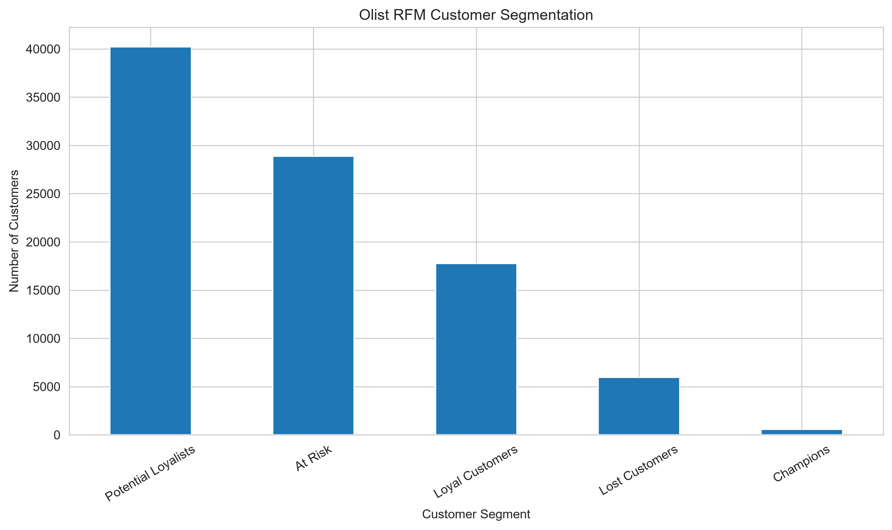

<p align="center">
  
  
  
  
  
  
</p>


# Brazilian E-commerce Sales Analytics

## Project Overview

This project analyses the Brazilian E-commerce Public Dataset by Olist to discover business insights, understand customer purchasing behaviour, and perform RFM-based customer segmentation.

The objective is to transform raw e-commerce data into meaningful business insights using Python and data visualisation.

## 📊 RFM Customer Segmentation Dashboard



## Business Objectives

- Analyse product and shipping revenue.
- Understand customer geographical distribution.
- Investigate customer purchasing behaviour.
- Identify repeat and one-time customers.
- Perform RFM customer segmentation.
- Identify valuable and at-risk customer groups.

## Dataset

Source: Brazilian E-commerce Public Dataset by Olist.

The project uses multiple datasets, including:
- Customers
- Orders
- Order Items
- Payments
- Products
- Reviews
- Sellers
- Geolocation

## Tools and Technologies

- Python
- Pandas
- NumPy
- Matplotlib
- Seaborn
- Jupyter Notebook
- VS Code
- Git and GitHub

## Analysis Performed

### 1. Data Exploration
- Dataset inspection
- Data types and missing values
- Basic statistical analysis

### 2. Revenue Analysis
- Monthly product revenue
- Monthly shipping revenue
- Revenue contribution analysis

### 3. Customer Analysis
- Customer distribution by city
- Customer distribution by state
- Customer purchase frequency

### 4. RFM Analysis

RFM stands for:

- Recency: How recently a customer purchased.
- Frequency: How frequently a customer purchased.
- Monetary: How much a customer spent.

### 5. Customer Segmentation

Customers were classified into five segments:

- Champions
- Loyal Customers
- Potential Loyalists
- At Risk
- Lost Customers

## Key Business Insights

- Product revenue contributes approximately 85.79% of combined revenue.
- Shipping revenue contributes approximately 14.21%.
- São Paulo represents the largest customer market.
- Most customers are one-time purchasers.
- RFM analysis helps identify valuable customers and retention opportunities.

## Project Structure

```text
ecommerce-sales-analytics/
│
├── data/
│   └── raw/
│
├── notebooks/
│   └── 01_data_exploration.ipynb
│
├── output/
│   ├── rfm_customer_analysis.csv
│   ├── customer_segment_revenue.csv
│   └── rfm_dashboard.png
│
├── README.md
└── requirements.txt
```

## Dashboard Preview

The project includes an RFM customer segmentation dashboard.


## Conclusion

This project demonstrates practical data analytics skills, including data cleaning, exploratory data analysis, revenue analysis, customer behaviour analysis, RFM modelling, and business insight generation.

The project is designed to demonstrate real-world data analytics capabilities.